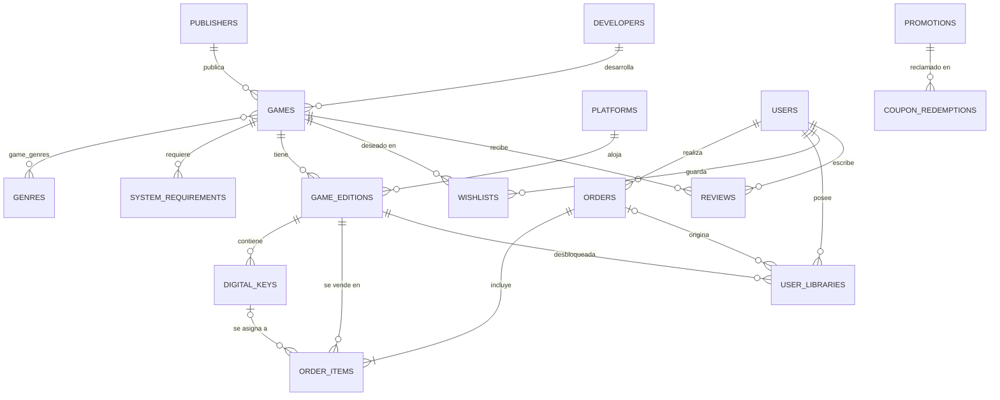

# 01. Base de Datos, Modelo Relacional y Auto-Seeding

Este documento explica cómo se configura la persistencia en el backend, qué representa cada una de las **17 entidades** de la base de datos y cómo se puebla el catálogo automáticamente al iniciar el servidor.

---

## 1. Cómo funciona el código en base general (Nivel Técnico)

### 1.1 Configuración de conexión (`AppModule`)

En [backend/src/app.module.ts](../backend/src/app.module.ts), `TypeOrmModule.forRootAsync` evalúa las variables de entorno cargadas por `ConfigModule.forRoot({ isGlobal: true })` y elige entre dos modos:

1. **Modo `DATABASE_URL` (PostgreSQL Serverless / Neon / Render)**:
   - Si existe la variable `DATABASE_URL`, configura TypeORM con `type: 'postgres'`, `url: databaseUrl`, `ssl: { rejectUnauthorized: false }`, `autoLoadEntities: true` y `synchronize: true`.
2. **Modo local o por variables individuales (`APP_*`)**:
   - Lee `APP_TYPE` (por defecto `'mysql'`; también soporta `'postgres'`), `APP_HOST` (`'localhost'`), `APP_PORT` (`3306` para MySQL o `5432` para PostgreSQL), `APP_USERNAME` (`'root'`), `APP_PASSWORD` (`'1111'`) y `APP_DATABASE` (`'tienda_videojuegos'`).
   - Activa SSL automáticamente si `APP_TYPE === 'postgres'`.
   - Usa `autoLoadEntities: true` y `synchronize: true` (TypeORM sincroniza las columnas y llaves foráneas al arrancar).

### 1.2 Las 17 Entidades del Modelo Relacional

Las entidades se organizan en cinco bloques funcionales:

#### A. Catálogo Base y Metadatos
| Entidad | Tabla | Campos clave | Relaciones | Archivo |
| :--- | :--- | :--- | :--- | :--- |
| `Publisher` | `publishers` | `id`, `name`, `websiteUrl`, `supportEmail`, `country` (ISO-2) | `1:N` con `Game` | [publisher.entity.ts](../backend/src/publishers/entities/publisher.entity.ts) |
| `Developer` | `developers` | `id`, `name`, `country`, `foundedYear` | `1:N` con `Game` | [developer.entity.ts](../backend/src/developers/entities/developer.entity.ts) |
| `Genre` | `genres` | `id`, `name`, `slug` (único), `description` | `N:M` con `Game` (tabla puente `game_genres`) | [genre.entity.ts](../backend/src/genres/entities/genre.entity.ts) |
| `Platform` | `platforms` | `id`, `name`, `code` (único, ej. `NSW`, `PS5`, `XSX`, `PC`), `iconUrl` | `1:N` con `GameEdition` | [platform.entity.ts](../backend/src/platforms/entities/platform.entity.ts) |

#### B. Videojuegos, Ediciones, Requisitos e Inventario Digital
| Entidad | Tabla | Campos clave | Reglas y restricciones | Archivo |
| :--- | :--- | :--- | :--- | :--- |
| `Game` | `games` | `id`, `title`, `slug` (único), `synopsis`, `esrbRating`, `releaseDate`, `coverImageUrl`, `discountCampaignName`, `discountPercentage`, `discountStartDate`, `discountEndDate`, `createdAt` | `publisher` y `developer` obligatorios con `onDelete: 'RESTRICT'`. `N:M` `genres` vía `game_genres`. | [game.entity.ts](../backend/src/games/entities/game.entity.ts) |
| `SystemRequirement` | `system_requirements` | `id`, `tier` (`MINIMUM`, `RECOMMENDED`, `ULTRA_RAYTRACING`), `os`, `processor`, `ramGb`, `graphicsCard`, `storageGb`, `directxVersion` | Pertenece a `Game` con `onDelete: 'CASCADE'`. | [system-requirement.entity.ts](../backend/src/system-requirements/entities/system-requirement.entity.ts) |
| `GameEdition` | `game_editions` | `id`, `editionName`, `format` (`DIGITAL`), `basePrice` (decimal `10,2`), `isDlc`, `createdAt` | Restricción `@Unique(['game', 'platform', 'editionName', 'format'])`. Pertenece a `Game` (`CASCADE`) y `Platform` (`RESTRICT`). | [game-edition.entity.ts](../backend/src/game-editions/entities/game-edition.entity.ts) |
| `DigitalKey` | `digital_keys` | `id` (**UUID**), `code`, `codeHash` (SHA-256 único), `status` (`AVAILABLE`, `RESERVED`, `ASSIGNED`, `REVOKED`), `batchId`, `updatedAt` | Pertenece a `GameEdition` con `onDelete: 'RESTRICT'` (impide borrar una edición si tiene claves). | [digital-key.entity.ts](../backend/src/digital-keys/entities/digital-key.entity.ts) |

#### C. Promociones, Cupones y Contenido Destacado
| Entidad | Tabla | Campos clave | Reglas y restricciones | Archivo |
| :--- | :--- | :--- | :--- | :--- |
| `Promotion` | `promotions` | `id`, `name`, `discountPercentage`, `couponCode`, `startDate`, `endDate`, `isActive`, `userId` (nullable) | Si `userId` es `null` es un cupón global; si tiene un ID, es personal (como `BIENVENIDA10`). | [promotion.entity.ts](../backend/src/promotions/entities/promotion.entity.ts) |
| `CouponRedemption` | `coupon_redemptions` | `id`, `userId`, `promotionId`, `orderId`, `claimedAt` | `@Unique(['userId', 'promotionId'])` garantiza **máximo 1 uso por usuario** incluso bajo concurrencia. | [coupon-redemption.entity.ts](../backend/src/promotions/entities/coupon-redemption.entity.ts) |
| `FeaturedTrailer` | `featured_trailers` | `id`, `slot` (único: `1`, `2` o `3`), `title`, `imageUrl`, `youtubeUrl`, `description` | Administra los 3 espacios de tráiler destacados en el inicio. | [featured-trailer.entity.ts](../backend/src/featured-trailers/entities/featured-trailer.entity.ts) |

#### D. Usuarios y Órdenes de Compra
| Entidad | Tabla | Campos clave | Reglas y restricciones | Archivo |
| :--- | :--- | :--- | :--- | :--- |
| `User` | `users` | `id`, `email` (único), `password` (`select: false`), `username` (único), `countryCode`, `isActive`, `role` (`ADMIN`, `CUSTOMER`), `createdAt` | `password` queda excluida por defecto de las consultas (`select: false`) y además se filtra con `sanitizeUser()`. | [user.entity.ts](../backend/src/users/entities/user.entity.ts) |
| `Order` | `orders` | `id`, `orderNumber` (único), `totalAmount`, `paymentStatus` (`PENDING`, `COMPLETED`, `FAILED`, `REFUNDED`), `paymentGatewayRef`, `createdAt` | Pertenece a `User` (`RESTRICT`). Tiene `1:N` `items` con `cascade: true`. | [order.entity.ts](../backend/src/orders/entities/order.entity.ts) |
| `OrderItem` | `order_items` | `id`, `unitPrice`, `discountApplied`, `subtotal` | Pertenece a `Order` (`CASCADE`), `GameEdition` (`RESTRICT`) y opcionalmente a `DigitalKey` (`SET NULL`). | [order-item.entity.ts](../backend/src/orders/entities/order-item.entity.ts) |

#### E. Biblioteca, Wishlist y Comunidad
| Entidad | Tabla | Campos clave | Reglas y restricciones | Archivo |
| :--- | :--- | :--- | :--- | :--- |
| `UserLibrary` | `user_libraries` | `id`, `acquiredAt`, `isRevoked` | Pertenece a `User` (`CASCADE`), `GameEdition` (`RESTRICT`) y `Order` (`SET NULL`). | [user-library.entity.ts](../backend/src/user-libraries/entities/user-library.entity.ts) |
| `Wishlist` | `wishlists` | `id`, `notifyOnSale`, `addedAt` | `@Unique(['user', 'game'])` evita duplicar el mismo juego en la wishlist de un usuario. `CASCADE` en ambos. | [wishlist.entity.ts](../backend/src/wishlists/entities/wishlist.entity.ts) |
| `Review` | `reviews` | `id`, `rating`, `title`, `body`, `isVerifiedPurchase`, `helpfulCount`, `createdAt` | Pertenece a `User` (`CASCADE`) y `Game` (`CASCADE`). El servicio valida 1 reseña por usuario y juego. | [review.entity.ts](../backend/src/reviews/entities/review.entity.ts) |

### Diagrama Entidad-Relación (Mermaid)

---

### 1.3 Cómo funciona el Seeding (Auto-Seeding y Seeding Manual)

El archivo [backend/src/database/seed.ts](../backend/src/database/seed.ts) define la función idempotente `executeSeed(dataSource)` y un runner CLI `runSeed()` (ejecutable con `pnpm run seed`). Además:
- **Auto-Seeding al arrancar**: `AppService.onApplicationBootstrap()` ([backend/src/app.service.ts](../backend/src/app.service.ts)) cuenta los registros en `games`. Si `count === 0`, ejecuta `executeSeed(this.dataSource)` automáticamente.
- **Endpoint manual**: `GET /seed` (protegido para rol `ADMIN` en [backend/src/app.controller.ts](../backend/src/app.controller.ts)) invoca `executeSeed()` bajo demanda.

**Qué crea `executeSeed()` exactamente**:
1. **Usuarios base**:
   - Administrador: toma `SEED_ADMIN_EMAIL`, `SEED_ADMIN_USERNAME` y `SEED_ADMIN_PASSWORD` de variables de entorno; fuera de producción usa por defecto `admin@tiendavideojuegos.local` / `admin` / `AdminDev123!`. En `NODE_ENV === 'production'`, si falta `SEED_ADMIN_PASSWORD`, omite la creación del admin por seguridad.
   - Cliente de prueba: `customer@tiendavideojuegos.local` / `gamer_mx` / `CustomerDev123!` (se omite si el email choca con `SEED_ADMIN_EMAIL`).
   - Las contraseñas se almacenan hasheadas con `hashPassword()` (`scrypt`).
2. **4 Plataformas**: `NSW` (Nintendo Switch), `PS5` (PlayStation 5), `XSX` (Xbox Series X|S) y `PC`.
3. **16 Géneros**: Acción, Aventura, RPG, Mundo Abierto, Plataformas, Lucha, Carreras, Shooter, Metroidvania, Simulación, Estrategia, Roguelike, Terror, Multijugador, Ciencia Ficción y Fantasía.
4. **12 Publishers** y **25 Desarrolladoras**.
5. **32 Videojuegos** (11 de Switch, 6 de PS5, 5 de Xbox Series X|S y 10 de PC), algunos con campañas de descuento iniciales (ej. *Metroid Dread* 20%, *God of War Ragnarök* 25%, *Cyberpunk 2077* 30%, *Elden Ring* 25%, *The Witcher 3* 50%, *Hades* 40%).
6. **Ediciones y Claves Digitales**: Para cada juego crea 2 ediciones digitales (`Standard Edition` al `basePrice` y `Deluxe Edition` a `basePrice + 19.99`) y **5 claves digitales `AVAILABLE`** únicas por edición (con su `codeHash` SHA-256).
7. **Requisitos de Sistema**: Para los 10 juegos de PC crea registros `MINIMUM` y `RECOMMENDED`.
8. **3 Cupones Promocionales**: `RETRO15` (15% activo), `FLASH20` (20% activo) y `VERANO25` (25% expirado, útil para validar el manejo de cupones caducados).

*(Nota: la tabla `featured_trailers` no se siembra en `seed.ts`; el frontend muestra un tráiler de respaldo por defecto hasta que un administrador configura los espacios 1, 2 o 3).*

---

## 2. Explicación fácil de entender

Piensa en la base de datos como **un gran archivero con 17 cajones conectados entre sí**, donde cada cajón tiene reglas estrictas para que nunca haya papeles perdidos ni datos contradictorios:

- **¿Por qué un videojuego no tiene el precio directamente?**
  Porque un mismo juego puede venderse como **Edición Estándar** o **Edición Deluxe**, y además en distintas plataformas (**PC, PlayStation, Xbox o Switch**). Por eso existe la carpeta `Game` (el título, la portada, la historia) y adentro las sub-carpetas `GameEdition` (la versión concreta con su precio).
- **¿Dónde viven las claves digitales (`DigitalKey`)?**
  Viven dentro de cada `GameEdition`, no dentro del juego en general. Así, si compras *Cyberpunk 2077 Standard Edition* para PC, el sistema saca una clave exactamente de esa edición y marca su estado de `AVAILABLE` (en estante) a `RESERVED` (apartada mientras pagas) y finalmente a `ASSIGNED` (ya es tuya).
- **¿Por qué hay una tabla aparte llamada `CouponRedemption`?**
  Porque los cupones (`Promotions`) son anuncios de descuento, pero `CouponRedemption` es la **lista de asistencia** que anota *"el usuario X ya usó el cupón Y en la orden Z"*. La base de datos prohíbe anotar dos veces la misma pareja usuario-cupón, evitando trampas aunque el usuario haga clic dos veces al mismo tiempo.
- **¿Qué pasa con los descuentos?**
  Existen dos tipos de rebaja que viven en lugares distintos:
  1. **Ofertas directas en el juego** (las que se ven con la etiqueta roja `OFERTA -25%` en la portada): se guardan dentro del propio juego (`Game`).
  2. **Cupones de código** (como `RETRO15` o `BIENVENIDA10`): se guardan en `Promotion` y se aplican en el carrito.
- **¿Y el usuario administrador?**
  No existe una tabla separada para administradores y clientes: todos están en `User`, diferenciados únicamente por su etiqueta `role` (`ADMIN` o `CUSTOMER`), y sus contraseñas nunca viajan hacia la pantalla porque la base de datos las protege con `select: false` y el servidor las limpia antes de responder.
