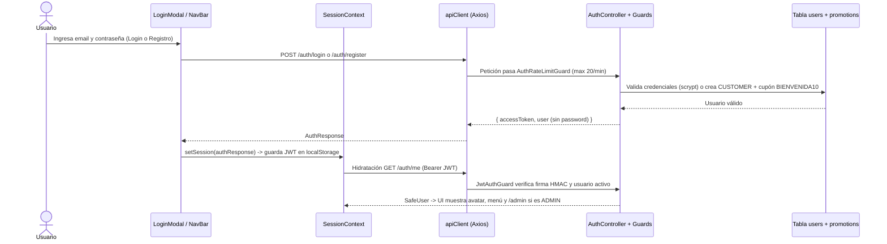

# 02. Autenticación, Seguridad, Guardias y Roles

Este documento explica cómo el sistema protege cuentas, contraseñas, tokens y rutas tanto en el backend (`NestJS`) como en el frontend (`React`).

---

## 1. Cómo funciona el código en base general (Nivel Técnico)

A diferencia de proyectos que dependen de `passport` o `bcrypt`, este sistema implementa la criptografía y validación JWT directamente usando el módulo nativo **`node:crypto`** de Node.js, reduciendo dependencias externas y manteniendo control total sobre el ciclo de autenticación.

### 1.1 Hashing de Contraseñas ([password.util.ts](../backend/src/auth/password.util.ts))

- **Algoritmo**: `scrypt` asíncrono (`promisify(scrypt)`) con un *salt* aleatorio de 16 bytes (`SALT_BYTES = 16`) y longitud de clave derivada de 64 bytes (`KEY_LENGTH = 64`).
- **Formato almacenado**: `scrypt$<saltHex>$<derivedKeyHex>`.
- **Verificación segura**: `verifyPassword(plainPassword, storedPassword)` compara los buffers mediante `timingSafeEqual` para prevenir ataques de temporización (*timing attacks*).
- **Migración transparente de contraseñas legacy**: Si en la base de datos existiera una contraseña antigua en texto plano (sin el prefijo `scrypt$`), `verifyPassword` realiza una comparación en tiempo constante usando SHA-256 y devuelve `needsRehash: true`; `AuthService.login()` re-hashea automáticamente esa contraseña a `scrypt` y la actualiza en base de datos.

### 1.2 Emisión y Verificación de Tokens JWT ([token.service.ts](../backend/src/auth/token.service.ts))

- **Formato**: JWT estándar `HS256` (`header.payload.signature` en `base64url`).
- **Payload**: `{ sub: number, email: string, role: UserRole, iat: number, exp: number }`.
- **Secreto (`getSecret()`)**:
  - En producción (`NODE_ENV === 'production'`), exige `process.env.JWT_SECRET` (lanza error en `onModuleInit()` si falta).
  - En desarrollo, usa `JWT_SECRET` si está configurado o el secreto de desarrollo por defecto (`DEV_JWT_SECRET`).
- **Expiración**: Configurable vía `JWT_EXPIRES_IN_SECONDS`; por defecto `86400` segundos (**24 horas**).
- **Validación**: Verifica estructura de 3 segmentos, cabecera exacta `{ alg: 'HS256', typ: 'JWT' }`, firma HMAC-SHA256 con `timingSafeEqual`, tipos del payload y expiración (`payload.exp <= now` → `401 Unauthorized`).

### 1.3 Rate Limiting en Autenticación ([auth-rate-limit.guard.ts](../backend/src/auth/guards/auth-rate-limit.guard.ts))

- Aplicado con `@UseGuards(AuthRateLimitGuard)` exclusivamente en `POST /auth/login` y `POST /auth/register`.
- Mantiene un `Map<string, { count, resetAt }>` en memoria indexado por la IP del cliente (`x-forwarded-for`, `req.ip` o `socket.remoteAddress`, con limpieza de entradas expiradas al alcanzar `10_000` IPs).
- Límite: **20 solicitudes cada 60 segundos** por IP. Si se supera, agrega la cabecera `Retry-After` y responde **HTTP `429 Too Many Requests`**.
- En entorno de pruebas (`NODE_ENV === 'test'`) se desactiva automáticamente salvo que se envíe la cabecera `x-enable-rate-limit: true`.

### 1.4 Guardias de Autenticación y Roles (`JwtAuthGuard` y `RolesGuard`)

1. **`JwtAuthGuard`** ([jwt-auth.guard.ts](../backend/src/auth/guards/jwt-auth.guard.ts)):
   - Lee el decorador `@Public()` (`IS_PUBLIC_KEY`).
   - **Si la ruta es `@Public()`** (como `GET /promotions`): permite pasar sin token, pero si llega un header `Authorization: Bearer ...` válido, intenta adjuntar `request.user` mediante `tryAttachUserFromToken()` (esto permite que `GET /promotions` devuelva si un cupón ya fue reclamado por el usuario logueado sin romper el acceso a visitantes anónimos).
   - **Si la ruta es protegida**: extrae el token Bearer, lo verifica con `TokenService.verify()`, consulta al usuario en `userRepository` para comprobar que sigue existiendo y que `user.isActive !== false`, e inyecta `request.user` (`AuthenticatedUser`), accesible vía `@CurrentUser()`.
2. **`RolesGuard`** ([roles.guard.ts](../backend/src/common/auth/roles.guard.ts)):
   - Lee el decorador `@Roles(...)` (`ROLES_KEY`).
   - Verifica que `request.user` exista, esté activo y su `role` esté incluido en `requiredRoles`. Si un endpoint tiene `@Roles()` vacío, deniega el acceso por seguridad (`403 Forbidden`).

### 1.5 Matriz de Control de Acceso en el Backend

- **Rutas públicas (sin token)**: `GET /`, `POST /auth/login`, `POST /auth/register`, `GET /games`, `GET /games/:id`, `GET /publishers*`, `GET /developers*`, `GET /genres*`, `GET /platforms*`, `GET /game-editions*`, `GET /system-requirements*`, `GET /promotions`, `GET /promotions/:id`, `GET /featured-trailers`, `GET /reviews`, `GET /reviews/game/:gameId`, `GET /reviews/:id`.
- **Rutas de usuario autenticado (con validación de propiedad)**:
  - `GET /auth/me`: perfil del usuario del token.
  - `GET /promotions/my`: cupones globales + personales del usuario con bandera `isClaimed`.
  - `GET/PATCH /users/:id`: un `CUSTOMER` solo puede leer/editar su propio ID y no puede modificar su `isActive` ni su `role`.
  - `POST/GET /orders`, `GET /orders/user/:userId`, `GET /orders/:id`, `POST /orders/:id/confirm-payment`: `CUSTOMER` solo puede crear/consultar/confirmar sus propias órdenes; además, si no es `ADMIN`, el estado inicial se fuerza a `PENDING`.
  - `GET /user-libraries/user/:userId`, `GET /user-libraries/:id`: restringido al dueño o `ADMIN`.
  - `POST/GET/PATCH/DELETE /wishlists*`: restringido al dueño o `ADMIN`.
  - `POST/PATCH/DELETE /reviews*`: restringido al dueño o `ADMIN` (al editar, un cliente no puede cambiar `userId` ni `gameId`).
- **Rutas exclusivas `ADMIN` (`@Roles(UserRole.ADMIN)`)**:
  - `GET /admin/summary`, `GET /seed`.
  - Toda escritura (`POST`, `PATCH`, `PUT`, `DELETE`) en catálogos (`games`, `games/discount-campaign`, `publishers`, `developers`, `genres`, `platforms`, `game-editions`, `system-requirements`, `promotions`, `featured-trailers`).
  - Todo el módulo `/digital-keys` (incluyendo `GET`, `POST /digital-keys/bulk`, `PATCH`, `DELETE`).
  - Gestión global de usuarios (`POST /users`, `GET /users`, `PATCH /users/:id/role`, `DELETE /users/:id` — impidiendo auto-eliminarse).
  - Listado global, actualización directa y borrado en `/orders` y `/user-libraries`.

### 1.6 Seguridad en el Frontend

- **Almacenamiento e interceptores** ([client.ts](../frontend/src/api/client.ts)):
  - El JWT se guarda en `localStorage` bajo `keneth.authToken`.
  - El interceptor de petición inyecta `Authorization: Bearer <token>`.
  - El interceptor de respuesta detecta errores `401` en endpoints autenticados (excluyendo `/auth/login` y `/auth/register`), borra el token almacenado y dispara `notifyUnauthorized()` para limpiar la sesión.
- **`SessionContext`** ([SessionContext.tsx](../frontend/src/context/SessionContext.tsx)):
  - Hidrata `currentUser` ejecutando `GET /auth/me` cuando hay token.
  - Ante `401` o `403`, ejecuta `logout()`, borra el token y purga las cachés protegidas de TanStack Query (`auth`, `orders`, `order`, `user-libraries`, `wishlists`, `users`, `user`, `digital-keys`).
- **`AdminRouteGuard`** ([AdminRouteGuard.tsx](../frontend/src/components/organisms/AdminRouteGuard.tsx)):
  - Envuelve todas las rutas `/admin/*` y las redirecciones `/catalog/*` en `App.tsx`. Si el usuario no está autenticado o `role !== 'ADMIN'`, muestra la pantalla de "Acceso Restringido" con opción de volver a la tienda o iniciar sesión (la seguridad real sigue recayendo siempre en el backend).

---

## 2. Explicación fácil de entender

La seguridad del sistema funciona como un **edificio con recepción, credenciales y zonas restringidas**:

1. **La caja fuerte de contraseñas (`scrypt`)**:
   Cuando creas tu cuenta, el sistema nunca anota tu contraseña real en la base de datos. En su lugar la mezcla con un código aleatorio único (*salt*) y la convierte en una huella matemática irreversible (`scrypt$...`). Si alguien entrara a mirar la base de datos, jamás podría leer tu contraseña.
2. **La pulsera sellada al entrar (JWT)**:
   Cuando haces login, el portero verifica tu contraseña y te entrega una **pulsera digital firmada con sello secreto** (el token JWT) válida por 24 horas. En cada clic que haces en la tienda (ver tu biblioteca, comprar o dejar una reseña), tu navegador muestra esa pulsera automáticamente en el encabezado `Authorization`. Si alguien intenta falsificar una sola letra de la pulsera, el sello no coincide y el backend la rechaza al instante.
3. **El guardia contra intentos repetidos (`AuthRateLimitGuard`)**:
   Si alguien intenta adivinar contraseñas probando muchas veces seguidas desde la misma dirección IP (más de 20 intentos en 1 minuto), el portero cierra temporalmente la ventanilla durante un minuto (error 429).
4. **Dos niveles de permiso (`CUSTOMER` y `ADMIN`) + Regla del dueño**:
   - **Visitante sin cuenta**: solo puede mirar la vitrina (juegos, precios, ofertas y reseñas).
   - **Cliente (`CUSTOMER`)**: puede comprar, usar sus cupones y ver **su** biblioteca, **su** wishlist y **sus** órdenes, pero el servidor le prohíbe estrictamente espiar o modificar las órdenes, bibliotecas o reseñas de otro usuario.
   - **Administrador (`ADMIN`)**: es el único que tiene la llave de la bodega (`/admin` y `/digital-keys`) para cargar claves, lanzar campañas de descuento, crear juegos o cambiar estados de órdenes.

### Flujo de autenticación y renovación de contexto

