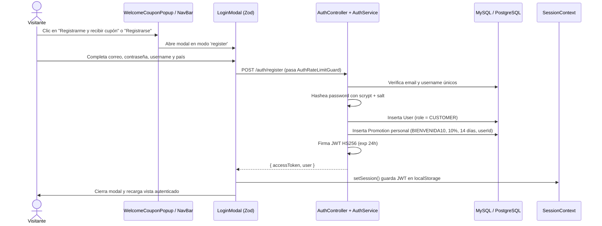
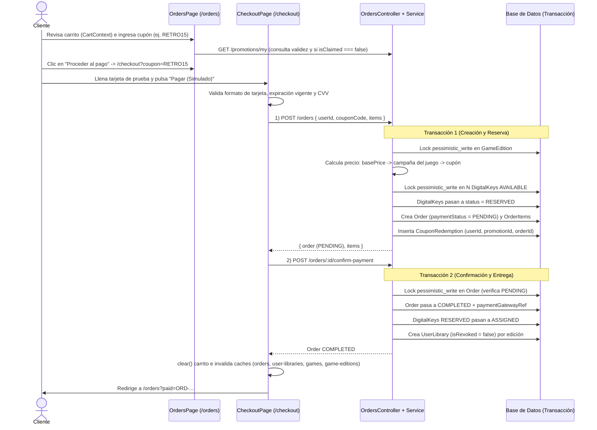

# 05. Flujos Completos del Proyecto (End-to-End)

Este documento une Frontend, Backend y Base de Datos recorriendo los **6 flujos principales del sistema** paso a paso, primero a nivel técnico y luego explicado de forma fácil de entender.

---

## Flujo 1: Arranque del sistema y Auto-Seeding inicial

### Explicación técnica
1. Se inicia el backend (`backend/src/main.ts`) → crea `AppModule` → `TypeOrmModule.forRootAsync` conecta a MySQL o PostgreSQL (`DATABASE_URL`) y sincroniza el esquema de las 17 tablas (`synchronize: true`).
2. Al finalizar la inicialización de los módulos, NestJS ejecuta `AppService.onApplicationBootstrap()` ([app.service.ts](../backend/src/app.service.ts)).
3. Consulta `gameRepo.count()`. Si es `0`, llama a `executeSeed(this.dataSource)` ([seed.ts](../backend/src/database/seed.ts)).
4. `executeSeed` siembra en orden referencial: usuarios base (`ADMIN` y `CUSTOMER`), 4 plataformas, 16 géneros, 12 publishers, 25 desarrolladoras, 32 juegos con sus ediciones (`Standard` y `Deluxe`), 5 claves `AVAILABLE` por edición (320 claves iniciales en total), requisitos de sistema para los 10 juegos de PC y 3 cupones promocionales (`RETRO15`, `FLASH20`, `VERANO25`).

### Explicación fácil
Cuando enciendes el servidor sobre una base de datos vacía, el sistema detecta que la tienda está sin mercancía y automáticamente llena el almacén con 32 videojuegos, sus versiones, sus claves listas para vender, cupones de ejemplo y las cuentas iniciales de administrador y cliente. Si reinicias después, ve que ya hay juegos y no duplica nada.

---

## Flujo 2: Registro, Cupón de Bienvenida e Inicio de Sesión

### Explicación técnica
- `AuthRateLimitGuard` permite hasta 20 solicitudes por minuto por IP.
- `AuthService.register()` fuerza siempre `role: UserRole.CUSTOMER`, normaliza `email` a minúsculas, crea el usuario con hash `scrypt`, genera la promoción personal `BIENVENIDA10` (`userId: savedUser.id`) y devuelve el `accessToken`.
- En el frontend, `LoginModal` guarda la sesión vía `SessionContext.setSession()`, invalida `wishlists`, `orders`, `user-libraries` y recarga la página para hidratar completamente la sesión desde `GET /auth/me`.

### Explicación fácil
Al visitante nuevo le aparece un aviso ofreciéndole un 10% de descuento si crea su cuenta. Al registrarse, el servidor guarda su contraseña cifrada, le regala automáticamente un cupón `BIENVENIDA10` válido solo para su cuenta por 14 días y le da su pase de acceso (JWT) para empezar a comprar.

---

## Flujo 3: Exploración del Catálogo, Tráilers, Ficha y Wishlist

### Explicación técnica
1. **`HomePage`** ([HomePage.tsx](../frontend/src/pages/HomePage.tsx)) carga en paralelo `GET /games`, `GET /promotions` (pública, pero con `JwtAuthGuard` opcional que marca `isClaimed` si hay sesión) y `GET /featured-trailers` desde `VideoShowcaseSection`.
2. **`VideoShowcaseSection`** ([VideoShowcaseSection.tsx](../frontend/src/components/molecules/VideoShowcaseSection.tsx)): si existen tráilers configurados en BD los muestra en orden de `slot` (1..3); si no, muestra un video de respaldo (`tTNosQAZszY`) asociado al primer juego con portada. Al reproducirse, escucha mensajes `postMessage` de YouTube (`onStateChange === 0`) para avanzar automáticamente al siguiente tráiler al terminar.
3. **`GamesPage`** ([GamesPage.tsx](../frontend/src/pages/GamesPage.tsx)): sincroniza búsqueda (`q`) y filtros (`genreId`, `platformId`, `maxPrice`, `developerId`) con `URLSearchParams`. Como `GET /games` y el filtro por plataforma requieren cruzar plataforma↔juego, consulta `GET /game-editions` para construir el mapa `gameIdsByPlatform`, aplica el cálculo de precio con `getActiveGameDiscount()` para el filtro `maxPrice` y pagina de 12 en 12 en el cliente.
4. **`GameDetailPage`** ([GameDetailPage.tsx](../frontend/src/pages/GameDetailPage.tsx)):
   - Consulta `GET /games/:id`, `GET /reviews/game/:gameId` y (si hay sesión) `GET /wishlists/user/:userId`.
   - El corazón de Wishlist dispara `POST /wishlists` o `DELETE /wishlists/:id`.
   - El selector de edición muestra las claves `AVAILABLE` reales y actualiza el precio con `getActiveGameDiscount(game)`.

### Explicación fácil
El usuario entra a la vitrina, puede hacer clic en "Hasta $15" en la sección de presupuestos (lo que lo lleva directo al catálogo filtrado por precio) o buscar un juego en la barra superior (`Ctrl+K`). Al abrir un juego ve su descripción, si tiene oferta activa, cuántas llaves digitales quedan disponibles para esa plataforma y las opiniones de otros jugadores. Si le gusta, lo guarda con el corazón en su Wishlist o lo añade al carrito.

---

## Flujo 4: Proceso Completo de Compra (Carrito → Cupón → Checkout → Llaves → Biblioteca)

Este es el flujo más importante de todo el proyecto. Involucra reserva optimista en UI, doble validación de cupones y transacción pesimista en base de datos:

### Explicación técnica
1. En `/orders`, el cliente valida visualmente el cupón contra la respuesta de `GET /promotions/my` (verificando vigencia e `isClaimed`).
2. En `/checkout`, al enviar el formulario, `CheckoutPage` realiza **dos llamadas secuenciales** al backend:
   - Primera llamada: `POST /orders`. Porque el usuario tiene rol `CUSTOMER`, `OrdersService.create()` fuerza `paymentStatus = PaymentStatus.PENDING`, bloquea la edición y las claves en BD, aplica primero el descuento de campaña del juego y luego el descuento del cupón, marca las claves como `RESERVED` y registra el uso del cupón en `coupon_redemptions`.
   - Segunda llamada: al recibir la orden en estado `PENDING`, llama inmediatamente a `POST /orders/:id/confirm-payment`. `OrdersService.confirmPayment()` bloquea la orden, la pasa a `COMPLETED`, asigna `paymentGatewayRef`, cambia las claves de `RESERVED` a `ASSIGNED` y crea las filas correspondientes en `user_libraries`.
3. Finalmente, vacía `CartContext`, invalida las cachés de React Query y redirige a `/orders?paid=<orderNumber>`.

### Explicación fácil
Imagina que llenas tu carrito y escribes tu cupón. Al darle a "Pagar":
1. Primero el cliente le dice a la tienda: *"quiero comprar esto con este cupón"*. La tienda aparta tus claves digitales en la bodega para que nadie más te las gane, registra que ya usaste ese cupón y genera tu ticket pendiente de pago.
2. Enseguida, la pantalla de pago simulado confirma el cobro de prueba y avisa a la tienda: *"pago aprobado"*. La tienda sella el ticket como pagado, te asigna definitivamente esas claves y coloca los juegos dentro de tu estante personal (**Mi Biblioteca**).

---

## Flujo 5: Post-Compra, Revelación de Claves y Reseña Verificada

### Explicación técnica
1. **Recibo (`/orders/:id`)**: `OrderDetailPage` consulta `GET /orders/:id` (el backend verifica que `order.user.id === currentUser.id` o que sea `ADMIN`). Muestra cada `OrderItem` con su precio, descuento aplicado y `digitalKey.code` listo para copiar.
2. **Biblioteca (`/library`)**: `LibraryPage` consulta `GET /user-libraries/user/:userId` (`isRevoked: false` con relaciones `gameEdition.game`, `gameEdition.platform` y `order.items.digitalKey`). Busca la clave digital emparejando `item.gameEdition.id === entry.gameEdition.id`, la muestra enmascarada y permite alternar visibilidad o copiarla al portapapeles.
3. **Reseña verificada (`/games/:id`)**: Cuando el usuario envía una reseña (`POST /reviews`), `ReviewsService.create()` consulta `user_libraries` para `(userId, gameId, isRevoked: false)`. Como el juego recién comprado ya está en su biblioteca, guarda `isVerifiedPurchase: true`, mostrando la insignia verde **Verificada** en `GameDetailPage`.

### Explicación fácil
Una vez que pagas, puedes ir a **Mis Juegos (Mi Biblioteca)** o a tu **Historial de Compras** para ver tus llaves digitales. En tu biblioteca aparecen tapadas por seguridad hasta que presionas "Revelar clave" o "Copiar". Y si decides calificar el juego con estrellas y un comentario, el sistema comprueba automáticamente que lo tienes en tu biblioteca y te marca como **Compra Verificada**.

---

## Flujo 6: Flujo Operativo del Administrador (`/admin`)

### Explicación técnica
1. Un usuario con `role === 'ADMIN'` hace clic en **Panel de Control** en `NavBar` (o navega a `/admin`).
2. `AdminRouteGuard` valida `currentUser?.role === UserRole.ADMIN` y renderiza `AdminControlPanelLayout` (con menú lateral fijo y ocultando el `NavBar` público).
3. **Operaciones disponibles**:
   - **Resumen (`/admin`)**: llama a `GET /admin/summary` (conteos agregados de juegos, desarrolladoras, llaves totales/disponibles, órdenes totales/completadas, promociones totales/activas y usuarios) y a `GET /game-editions` para alertar sobre ediciones con 0 o pocas claves.
   - **Alta integral de juegos (`/admin/games`)**: `GamesAdminPage` permite crear un juego (`POST /games`) y, opcionalmente en el mismo modal, encadenar `POST /game-editions` + `POST /digital-keys/bulk`. También ofrece el modal **"Stock y Claves"** para añadir nuevas ediciones y generar lotes de 1 a 100 claves sin salir de la tabla.
   - **Carga masiva de claves (`/admin/digital-keys`)**: `DigitalKeysPage` soporta generación automática o pegado manual de códigos separados por líneas o comas (`POST /digital-keys/bulk`).
   - **Campañas de descuento (`/admin/discount-campaigns`)**: `DiscountCampaignsPage` envía `POST /games/discount-campaign` sobre múltiples `gameIds` para activar o limpiar descuentos temporales.
   - **Tráilers (`/admin/featured-trailers`)**: `FeaturedTrailersPage` configura los espacios `1`, `2` y `3` vía `PUT /featured-trailers/:slot` o los vacía vía `DELETE /featured-trailers/:slot`.
   - **Órdenes (`/admin/orders`)**: `AdminOrdersPage` lista todas las órdenes de la tienda (`GET /orders`), permite filtrar por `PaymentStatus` y actualizar su estado vía `PATCH /orders/:id`.

### Explicación fácil
Cuando entra el dueño o administrador de la tienda, aparece un botón dorado llamado **Panel de Control**. Ahí tiene su oficina privada: ve de un vistazo cuántos juegos y órdenes hay, detecta al instante qué juego se está quedando sin claves digitales para fabricar un lote nuevo de 10 o 100 códigos en dos clics, aplica rebajas de fin de semana a varios juegos a la vez, cambia los 3 tráilers de YouTube de la portada y supervisa todas las compras de los clientes.
