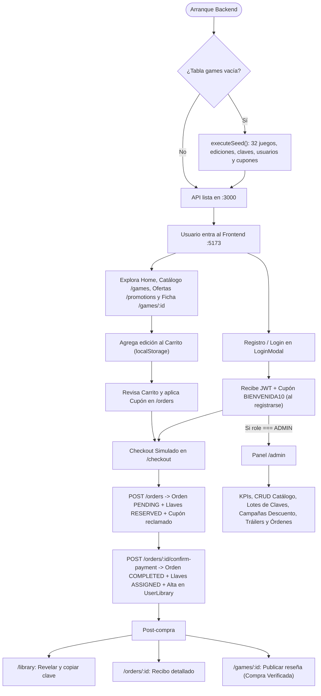

# Explicación Completa del Sistema — Tienda de Videojuegos (`EL PIBES`)

Bienvenido a la documentación arquitectónica y funcional completa del proyecto **Tienda de Videojuegos (`EL PIBES`)**. Este documento explica **cómo funciona el código a nivel técnico general**, presenta una **explicación fácil de entender** pensada para cualquier persona y organiza el recorrido completo por todo el flujo del proyecto.

---

## Índice de la Documentación por Secciones

Para evitar un único archivo interminable, la explicación se divide en este documento maestro (visión general + guía sencilla) y cinco documentos especializados por capa y flujo:

| Documento | Qué explica |
| :--- | :--- |
| **[README.md](./README.md)** *(este archivo)* | Visión general técnica del código, explicación fácil de entender con analogías y mapa global del sistema. |
| **[01-base-de-datos-y-modelo-relacional.md](./01-base-de-datos-y-modelo-relacional.md)** | Conexión TypeORM (MySQL / PostgreSQL), las **17 entidades** del modelo relacional y el sistema de **Auto-Seeding**. |
| **[02-autenticacion-seguridad-y-roles.md](./02-autenticacion-seguridad-y-roles.md)** | Hashing `scrypt`, firma manual de JWT (`HS256`), guardias de ruta, rate limiting, roles (`ADMIN` / `CUSTOMER`) y sesión en frontend. |
| **[03-backend-modulos-y-logica-de-negocio.md](./03-backend-modulos-y-logica-de-negocio.md)** | Los 16 módulos NestJS, mapa completo de endpoints REST y la lógica crítica (órdenes transaccionales, claves digitales, cupones y reseñas). |
| **[04-frontend-spa-y-arquitectura-ui.md](./04-frontend-spa-y-arquitectura-ui.md)** | Arquitectura React 19 + Vite + TanStack Query, cliente HTTP Axios, contextos, Atomic Design, motor CRUD genérico y todas las vistas. |
| **[05-flujos-del-proyecto-end-to-end.md](./05-flujos-del-proyecto-end-to-end.md)** | Recorridos completos paso a paso (desde el arranque hasta la compra, entrega de llaves, reseñas verificadas y panel admin). |

---

## 1. Cómo funciona el código en base general (Visión Técnica)

El proyecto es una aplicación web **Full-Stack desacoplada (Cliente-Servidor)** dividida en dos grandes aplicaciones dentro del mismo repositorio:

1. **`backend/` — API REST en NestJS + TypeORM**:
   - **Tecnologías principales**: NestJS 12, TypeScript 6, Express, TypeORM 1.1, `class-validator`, `class-transformer`, `mysql2` / `pg` (Neon PostgreSQL).
   - **Puerto por defecto**: `3000` (sin prefijo global en las rutas; por ejemplo `/games`, `/auth/login`, `/orders`).
   - **Punto de entrada**: [backend/src/main.ts](../backend/src/main.ts) inicializa `AppModule`, habilita CORS y aplica un `ValidationPipe` global (`whitelist: true`, `forbidNonWhitelisted: true`, `transform: true`, `enableImplicitConversion: true`) que filtra y valida cada petición entrante contra su DTO.
   - **Arquitectura modular**: [backend/src/app.module.ts](../backend/src/app.module.ts) registra `ConfigModule` (variables de entorno globales), `TypeOrmModule.forRootAsync` (selección automática entre `DATABASE_URL` para PostgreSQL o `APP_TYPE` para MySQL/PostgreSQL local con `synchronize: true`) y **16 módulos de dominio**:
     - Catálogo base: `PublishersModule`, `DevelopersModule`, `GenresModule`, `PlatformsModule`.
     - Producto e inventario: `GamesModule`, `SystemRequirementsModule`, `GameEditionsModule`, `DigitalKeysModule`.
     - Comercio y marketing: `PromotionsModule`, `OrdersModule`, `FeaturedTrailersModule`.
     - Usuarios, seguridad y comunidad: `AuthModule`, `UsersModule`, `UserLibrariesModule`, `WishlistsModule`, `ReviewsModule`.
   - **Auto-inicialización**: Al arrancar la aplicación, `AppService.onApplicationBootstrap()` ([backend/src/app.service.ts](../backend/src/app.service.ts)) verifica si la tabla `games` está vacía; si lo está, ejecuta automáticamente `executeSeed()` ([backend/src/database/seed.ts](../backend/src/database/seed.ts)) para poblar usuarios base, plataformas, géneros, publishers, desarrolladoras, 32 videojuegos, ediciones digitales, llaves y cupones de ejemplo.
   - **Seguridad nativa sin dependencias externas de JWT/bcrypt**: `AuthModule` implementa hashing de contraseñas con `node:crypto` (`scrypt`) y tokens JWT `HS256` firmados manualmente mediante HMAC-SHA256 y comparados con `timingSafeEqual`.

2. **`frontend/` — SPA en React 19 + Vite + Tailwind CSS v4**:
   - **Tecnologías principales**: React 19, Vite 8, TypeScript, React Router DOM 7, TanStack React Query 5, Axios, React Hook Form + Zod, Tailwind CSS v4.
   - **Puerto de desarrollo**: `5173` ([frontend/vite.config.ts](../frontend/vite.config.ts)). Se conecta al backend mediante `VITE_API_URL` (por defecto `http://localhost:3000`) o mediante el proxy `/api` configurado en Vite.
   - **Punto de entrada y estado global**: [frontend/src/main.tsx](../frontend/src/main.tsx) envuelve la aplicación en cuatro proveedores:
     1. `QueryClientProvider` (caché y sincronización de peticiones al servidor).
     2. `BrowserRouter` (enrutamiento SPA).
     3. `SessionProvider` (token JWT en `localStorage`, hidratación de usuario con `GET /auth/me` y cierre de sesión automático ante `401`/`403`).
     4. `CartProvider` (carrito persistido en `localStorage` bajo la clave `keneth.cart`, guardando solo `{ gameEditionId, quantity }`).
   - **Capa de comunicación**: [frontend/src/api/client.ts](../frontend/src/api/client.ts) crea la instancia `apiClient` de Axios con dos interceptores: uno de **petición** que inyecta `Authorization: Bearer <token>`, y uno de **respuesta** que limpia la sesión ante un `401` y transforma errores HTTP en instancias legibles de `ApiError`.
   - **UI y rutas**: [frontend/src/App.tsx](../frontend/src/App.tsx) carga las páginas de forma perezosa (`React.lazy` + `Suspense`) separando dos grandes áreas:
     - **Tienda pública y zona de cliente** (`/`, `/games`, `/games/:id`, `/promotions`, `/orders`, `/checkout`, `/orders/:id`, `/library`, `/wishlist`, `/my-coupons`, `/users/:id`).
     - **Panel de Control Administrativo** (`/admin/*`), protegido por `AdminRouteGuard` y estructurado con barra lateral fija (`AdminControlPanelLayout`), donde gran parte de los catálogos reutilizan el componente genérico `CrudResourcePage` guiado por esquemas Zod declarativos (`fields.ts`).

### Diagrama general de arquitectura

```mermaid
flowchart LR
    U["Usuario / Navegador"] --> FE["Frontend SPA (React 19 + Vite)"]
    subgraph FE_CAPAS["Capas del Frontend"]
        UI["Páginas y Atomic Design"]
        CTX["SessionContext + CartContext"]
        RQ["TanStack Query (Caché)"]
        API["apiClient (Axios + Interceptores JWT)"]
        UI --> CTX
        UI --> RQ
        RQ --> API
    end
    FE --> FE_CAPAS
    API -- "HTTP REST + JSON + Bearer JWT" --> BE["Backend API (NestJS 12)"]
    subgraph BE_CAPAS["Capas del Backend"]
        PIPE["ValidationPipe Global + CORS"]
        GUARD["Guards (JwtAuthGuard, RolesGuard, RateLimit)"]
        CTRL["Controllers (Rutas REST)"]
        SVC["Services (Reglas y Transacciones)"]
        ORM["TypeORM Repositories"]
        PIPE --> GUARD --> CTRL --> SVC --> ORM
    end
    BE --> BE_CAPAS
    ORM -- "SQL (MySQL o PostgreSQL Neon)" --> DB[("Base de Datos Relacional (17 tablas)")]
```

---

## 2. Explicación fácil de entender (Sin tecnicismos)

Imagina que este proyecto es una **tienda digital de videojuegos llamada `EL PIBES`** que funciona exactamente igual que una tienda física moderna, pero todo ocurre por internet y las entregas son **códigos digitales** (como los códigos de activación de Steam, Nintendo eShop, PlayStation o Xbox) en lugar de cajas de plástico.

El sistema se divide en **tres grandes partes** que trabajan juntas:

1. **La Vitrina y el Mostrador (`frontend/`)**: Es todo lo que el jugador ve y toca en la pantalla: los banners de portada, los filtros de precios, el carrito de compras, la pantalla de pago y el perfil. No guarda precios oficiales ni decide si un cupón es válido por su cuenta; siempre le pregunta a la oficina central.
2. **La Oficina Central y Bodega (`backend/`)**: Es el cerebro del negocio. Nadie puede ver las claves digitales directamente sin permiso. La oficina recibe pedidos, verifica quién eres, revisa si un juego está en oferta, aplica cupones sin dejar que los uses dos veces, cobra (de forma simulada) y saca una clave única de la bodega para entregártela.
3. **El Archivero Permanente (Base de Datos)**: Es donde queda todo anotado de forma segura en 17 "carpetas" (tablas): qué juegos existen, qué ediciones tienen, qué claves hay disponibles, qué usuarios están registrados, qué compró cada uno y qué reseñas escribieron.

### ¿Cómo funciona todo el viaje de principio a fin?

1. **Cuando el sistema enciende por primera vez**: El backend revisa si el archivero está vacío. Si no hay ningún juego guardado, automáticamente "llena los estantes" con 32 videojuegos reales, sus plataformas (Switch, PS5, Xbox, PC), géneros, requisitos de PC, ediciones (`Standard` y `Deluxe`), **5 claves digitales listas para vender por cada edición**, cupones de prueba y dos cuentas iniciales (un administrador y un cliente).
2. **Un visitante entra a la tienda**: Ve el carrusel principal (Zelda, GTA VI, Castlevania), el catálogo, la sección de tráilers de YouTube, accesos por presupuesto ($5, $10, $15, $20) y un pequeño aviso invitándolo a registrarse para ganar el cupón `BIENVENIDA10` (10% de descuento).
3. **El visitante crea su cuenta o inicia sesión**:
   - Cuando se registra, la oficina central cifra su contraseña (nunca la guarda en texto legible), le crea automáticamente un cupón personal `BIENVENIDA10` válido por 14 días y le entrega una "credencial sellada" (token JWT) para que no tenga que volver a escribir su contraseña en cada clic.
4. **Explora juegos y arma su carrito**:
   - Puede buscar juegos, filtrar por género, plataforma, presupuesto o estudio, ver los detalles y requisitos de PC, o guardar un juego en su **Lista de Deseados (Wishlist)** con el botón del corazón.
   - Cuando agrega una edición al carrito, el navegador recuerda ese carrito localmente incluso si recarga la página.
5. **Pasa por caja (Checkout) y recibe su juego**:
   - En la pantalla del carrito puede escribir un código de cupón (por ejemplo `BIENVENIDA10` o `RETRO15`).
   - En la pantalla de Checkout llena una tarjeta de prueba (no cobra dinero real).
   - Al confirmar, el backend hace una **operación todo-o-nada** (transacción):
     1. Bloquea temporalmente las claves disponibles para que dos clientes no compren la misma clave al mismo segundo.
     2. Calcula el precio real en el servidor (aplicando primero la oferta del juego si tiene campaña activa, y encima el descuento del cupón).
     3. Crea la orden primero en estado `PENDING` reservando la clave (`RESERVED`), y enseguida confirma el pago pasando la orden a `COMPLETED` y la clave a `ASSIGNED`.
     4. Anota el cupón en el registro de cupones usados para que ese usuario no pueda reutilizarlo.
     5. Deposita el juego automáticamente en **Mi Biblioteca** (`/library`).
6. **Usa su juego y opina**:
   - El cliente entra a **Mi Biblioteca**, pulsa **"Revelar clave"** o **"Copiar"** para obtener su código estilo `XXXX-XXXX-XXXX-XXXX` y también puede ver su recibo en el historial de órdenes.
   - Si vuelve a la ficha del juego y escribe una reseña, el sistema revisa si el juego está en su biblioteca; si lo compró ahí, le coloca automáticamente la insignia verde de **Compra Verificada**.
7. **Mientras tanto, el Administrador gestiona la tienda**:
   - Solo las cuentas con rol `ADMIN` ven el botón amarillo **Panel de Control** (`/admin`).
   - Desde ahí el administrador ve las métricas en vivo, detecta qué ediciones se están quedando sin claves digitales, genera lotes nuevos de hasta 100 claves con un clic, crea juegos nuevos con su edición inicial, lanza campañas masivas de descuento (etiqueta `OFERTA -X%`), administra cupones, configura los 3 tráilers de la portada y supervisa todas las órdenes.

---

## 3. Mapa completo del flujo del proyecto

---

## 4. Guía rápida para empezar a leer el código

Si vas a explorar o modificar el proyecto por primera vez, el orden más claro es:

1. **Modelo de datos y arranque**: lee [01-base-de-datos-y-modelo-relacional.md](./01-base-de-datos-y-modelo-relacional.md) para entender cómo se conectan las 17 tablas.
2. **Seguridad y permisos**: lee [02-autenticacion-seguridad-y-roles.md](./02-autenticacion-seguridad-y-roles.md) para saber cómo viaja el JWT del frontend al backend y qué protege cada ruta.
3. **Reglas de negocio en el servidor**: lee [03-backend-modulos-y-logica-de-negocio.md](./03-backend-modulos-y-logica-de-negocio.md) para entender `OrdersService`, `DigitalKeysService`, `PromotionsService` y `GamesService`.
4. **Interfaz y consumo de API**: lee [04-frontend-spa-y-arquitectura-ui.md](./04-frontend-spa-y-arquitectura-ui.md) para ubicar cada pantalla, contexto y el patrón `CrudResourcePage`.
5. **Trazabilidad completa**: consulta [05-flujos-del-proyecto-end-to-end.md](./05-flujos-del-proyecto-end-to-end.md) cada vez que necesites seguir un caso de uso completo de punta a punta.
