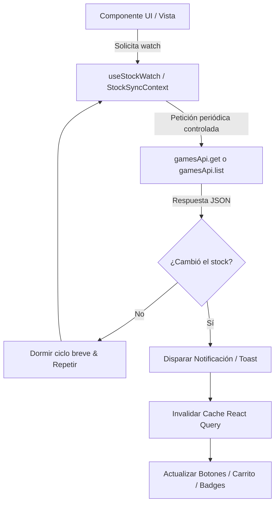

# Plan de Implementación: Long Polling para Avisos de Stock en Tiempo Real (Frontend Only)

## 1. Contexto y Objetivos

- **Objetivo:** Sincronizar en tiempo real el estado del stock de cualquier producto/edición en el frontend sin realizar modificaciones en el backend existente.
- **Restricción principal:** Cero cambios en el código del backend (`NestJS`, base de datos o endpoints).
- **Entorno existente:**
  - El backend expone `GET /games` (lista completa con ediciones y sus `digitalKeys`) y `GET /games/:id` (detalle con ediciones y `digitalKeys`).
  - Cada edición cuenta con `digitalKeys: DigitalKey[]` donde cada clave tiene un `status: KeyStatus.AVAILABLE | RESERVED | ASSIGNED | REVOKED`.
  - La utilidad existente `countAvailableKeys(edition)` en `frontend/src/utils/domain.ts` calcula las claves en stock activo.

---

## 2. Definición Técnica: Long Polling vs Short Polling vs Client-Side Adaptive Long-Polling

### 2.1. Long Polling Estricto vs Polling Adaptativo
- **Long Polling tradicional:** El servidor mantiene abierta la conexión HTTP hasta que ocurre un evento de cambio o un timeout.
- **Escenario Frontend-Only:** Dado que el backend actual responde de inmediato a las peticiones REST (`GET /games/:id` y `GET /games`), un bucle continuo clásico saturaría el servidor.
- **Solución implementada:** **Client-Side Adaptive Long-Polling** (bucle continuo secuencial con backoff, abort controller, detección de visibilidad y revalidación reactiva):
  1. El cliente ejecuta una petición de sondeo de stock.
  2. Tan pronto recibe la respuesta, compara el hash o valor del stock contra el snapshot anterior.
  3. Si hay cambio, emite un aviso inmediato y actualiza React Query / Store.
  4. Encadena la siguiente petición inmediatamente o tras un micro-retraso configurable (ej. 2-4 segundos en segundo plano, 1-2s en checkout/detalle de producto).
  5. Se detiene automáticamente si la pestaña pasa a segundo plano (`document.visibilityState === 'hidden'`) o si la ventana pierde foco, evitando agotar recursos.

---

## 3. Arquitectura de la Solución

### 3.1. Dónde se aplicará el monitoreo:
1. **Detalle de Videojuego (`GameDetailPage.tsx`):**
   - Monitorea `GET /games/:id`.
   - Si la edición activa se queda sin stock (`stock === 0`), desactiva el botón "Añadir al carrito", muestra el badge "Agotado" y lanza una alerta flotante (*"¡Se acaban de agotar las claves para esta edición!"*).
   - Si una edición agotada recibe nuevas claves, notifica: *"¡Stock disponible nuevamente!"*.

2. **Carrito / Checkout (`CartContext.tsx` / `CheckoutPage.tsx`):**
   - Monitorea periódicamente las ediciones agregadas al carrito.
   - Si un producto del carrito se queda sin stock mientras el usuario está en el checkout, le avisa y previene errores en la compra.

3. **Catálogo (`GamesPage.tsx`):**
   - Sondeo pasivo de la lista de juegos (`queryKey: ['games']`) con `refetchInterval` inteligente cuando la pestaña está activa.

---

## 4. Diseño del Módulo de Long Polling

### 4.1. Hook Reutilizable: `useStockWatch`
Ubicación propuesta: `frontend/src/hooks/useStockWatch.ts`

**Capacidades:**
- Soporte para observar un juego puntual (`gameId`) o una edición (`gameEditionId`).
- Cancelación limpia con `AbortController` al desmontar el componente.
- Detección de visibilidad (`Page Visibility API`): detiene el sondeo si el usuario minimiza el navegador.
- Historial de stock previo para comparar:
  - `AVAILABLE` -> `0`: Alerta de stock agotado.
  - `0` -> `AVAILABLE`: Alerta de reabastecimiento.
  - Reducción brusca (`<= 2` unidades restantes): Alerta de *"¡Últimas unidades disponibles!"*.
- Emisión de callbacks `onStockChange(editionId, previousStock, newStock)` y toast / banner visual.

### 4.2. Notificaciones al Usuario (Avisos de Stock)
- Componente flotante tipo `StockToast` o banner en cabecera de la página.
- Sin dependencias externas pesadas (usando estilos Tailwind existentes del sistema de diseño).

---

## 5. Fases de Implementación

### Fase 1: Creación del Hook de Monitoreo (`useStockWatch.ts`)
- Implementar el hook que gestione el loop asíncrono con control de ciclo de vida de React (`useEffect`).
- Integrar `gamesApi.get(gameId)` y cálculo mediante `countAvailableKeys`.
- Agregar control de pausas cuando la ventana no está visible.

### Fase 2: Integración en la Ficha de Producto (`GameDetailPage.tsx`)
- Integrar `useStockWatch({ gameId, enabled: true })`.
- Mostrar advertencias visuales dinámicas:
  - Alerta de "Stock bajo" si quedan 1 o 2 claves.
  - Alerta inmediata si el stock baja a 0 en tiempo real.
  - Cambio automático del estado del botón "Añadir al carrito" a disabled con etiqueta "Agotado".

### Fase 3: Integración en Carrito y Checkout (`CartContext.tsx` y `CheckoutPage.tsx`)
- Validar stock de los items seleccionados antes de enviar la orden.
- Si mientras está en la pantalla de pago una de las ediciones seleccionadas se queda sin stock, bloquear el botón de pago y notificar al usuario para que ajuste su carrito.

### Fase 4: Pruebas y Validación
- Probar la alternancia de estados de claves (creando o cambiando claves desde el panel de admin o base de datos y observando la reacción inmediata en el frontend sin recargar la página).
- Validar que no existan memory leaks o peticiones desbocadas al navegar entre rutas.

---

## 6. Consideraciones de Rendimiento y Buenas Prácticas

1. **Evitar saturar el servidor:** Establecer intervalos de sondeo seguros (entre 3 y 5 segundos por cliente activo).
2. **Consumo de batería / red:** Si `document.hidden === true`, pausar inmediatamente el temporizador.
3. **Manejo de errores de red:** En caso de error `5xx` o caída de conexión, aplicar retroceso exponencial (*exponential backoff*: 3s, 6s, 12s, max 30s) en lugar de insistir agresivamente.
